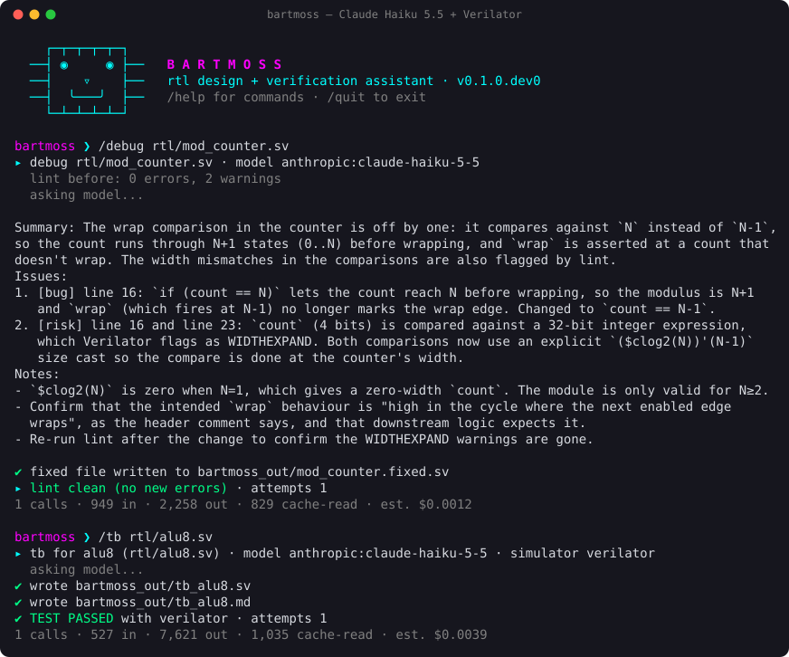

# Bartmoss

[](https://github.com/GravityID21/Bartmoss/actions/workflows/ci.yml)

An open-source AI assistant for RTL design and verification that runs in your terminal and works with any model. Generated and fixed RTL is checked with a real simulator before you see it.

> Status: Phase 1 MVP, under active development. See [SPEC.md](SPEC.md) for the full roadmap and progress tracker.



*A real session: Claude Haiku 5.5 finds the bug, the fix is re-linted by Verilator, and the generated testbench is compiled and run before it's written out.*

## What it does

| Command | What happens |
|---|---|
| `bartmoss ask "..."` | Hardware design theory Q&A (multi-turn in the REPL). `@path` attaches a file; `--web` (or `/web on`) lets Claude search the web, with sources listed. |
| `bartmoss debug file.sv` | Lints with Verilator and checks synthesis with Yosys (if installed), asks the model for an analysis and a fixed file, re-checks the fix, retries if it introduced errors or latches, then writes `bartmoss_out/file.fixed.sv`. Your original is never touched. |
| `bartmoss tb file.sv` | Generates a self-checking directed testbench plus Markdown notes, compiles and runs it, and retries on compile errors. Reports PASS/FAIL. |
| `bartmoss vplan spec.md` | Writes a verification plan (features → checks → coverage → edge cases) to `bartmoss_out/spec.vplan.md`. Takes a spec, README or RTL file. |
| `bartmoss uvmplan spec.md` | Designs a UVM environment (agents, transactions, sequences, scoreboard, coverage, tests, build order) as `bartmoss_out/spec.uvmplan.md`. |
| `bartmoss eval --mode debug\|tb` | Scores a model on the cases in `evals/cases/`, graded by the simulator. |
| `bartmoss` | Interactive REPL (`/help` lists commands). |

## Install

```bash
python3 -m venv .venv && source .venv/bin/activate
pip install -e ".[claude]"      # or ".[openai]" or ".[all]"; the core has no dependencies
brew install verilator           # free SystemVerilog simulator/linter (5.050+ recommended)
brew install nvc                 # optional: VHDL-2008 support (GHDL also works on Linux)
cp .env.example .env             # add the API key(s) you want to use
                                 # (or put them in ~/.config/bartmoss/.env to use them from any folder)
bartmoss doctor                  # check what's installed
```

To try it with no API key at all, use the offline mock model: `bartmoss --model mock:echo`.

## Choosing models

Models are written as `provider:model`:

```bash
bartmoss --model anthropic:claude-haiku-5-5 ask "why use gray code for async FIFO pointers?"
bartmoss --model ollama:qwen2.5-coder:14b tb rtl/alu.sv      # local and free, needs Ollama
bartmoss --model deepseek:deepseek-chat debug rtl/fifo.sv
```

Built-in providers: `anthropic`, `openai`, `ollama`, `deepseek`, `openrouter`, `gemini`, `mock`. You can add any OpenAI-compatible endpoint, and set a default model per mode, in `bartmoss.json`:

```json
{
  "default_model": "anthropic:claude-sonnet-5-5",
  "modes": {"ask": {"model": "anthropic:claude-haiku-5-5"}},
  "providers": {"lmstudio": {"type": "openai_compat", "base_url": "http://localhost:1234/v1", "api_key_env": null}}
}
```

## Results

31 cases, each run three times (2026-10-24). Full table and notes: [evals/LEADERBOARD.md](evals/LEADERBOARD.md). See [evals/README.md](evals/README.md) for how scores are graded.

| Model | `/debug` (16 cases) | `/tb` (10 cases) | Cost per debug pass |
|---|---|---|---|
| Claude Haiku 5.5 | **1.00** (48/48 runs) | pending | $0.02 |
| Claude Sonnet 5.5 | 0.92 | **0.79** | $0.27 |
| Qwen2.5-Coder 7B (local) | 0.44 | 0.07 | $0 |

Haiku is the default for `/debug`. Testbench generation is the hardest mode: even Sonnet sometimes writes wrong expected values for a correct design.

## Cost

You use your own API keys, so you pay only for what you run. `/usage` in the REPL shows tokens and an estimated cost. Ways to keep it cheap: use the `mock` provider or a local Ollama model while developing, give `/ask` a cheap model, and save frontier models for `/debug`, `/tb` and eval runs.

## Development

```bash
python -m unittest          # offline; simulator tests skip if Verilator is missing
```

## Licence

[MIT](LICENSE). The eval cases include RTL from the author's own MIT-licensed RTL projects.
